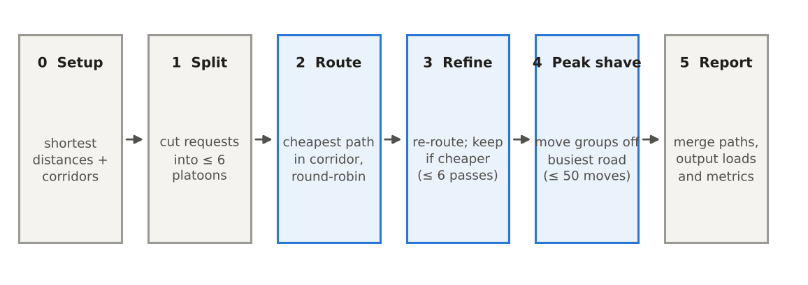
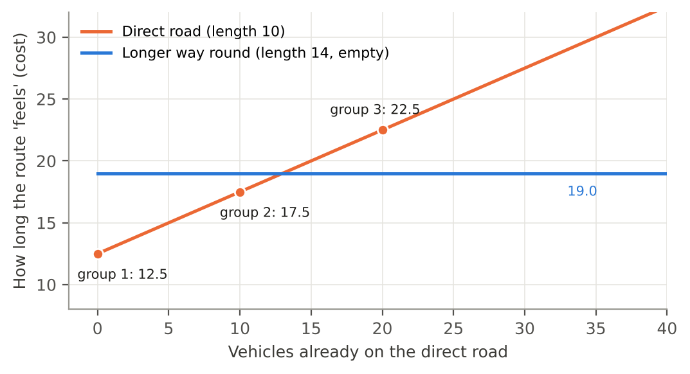
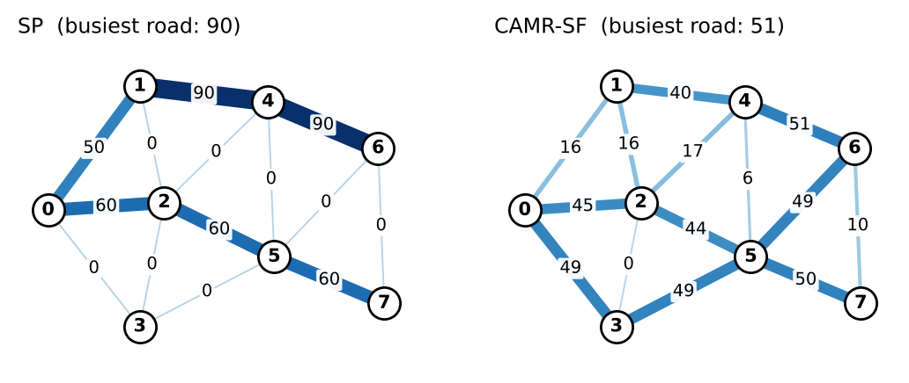
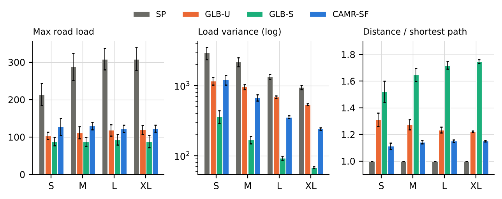
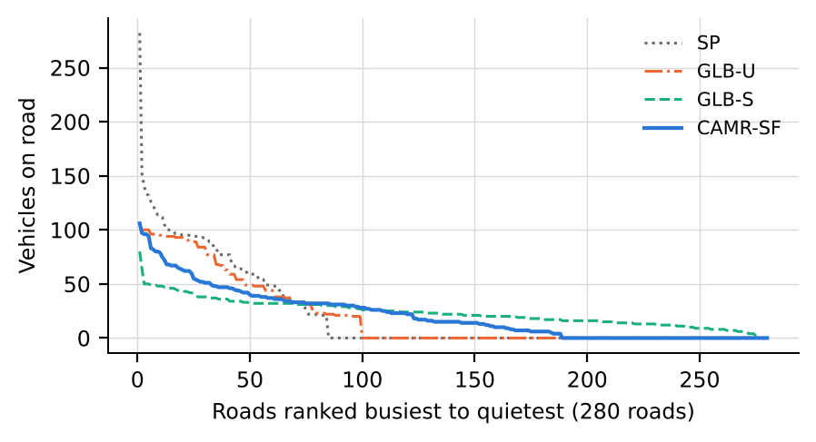
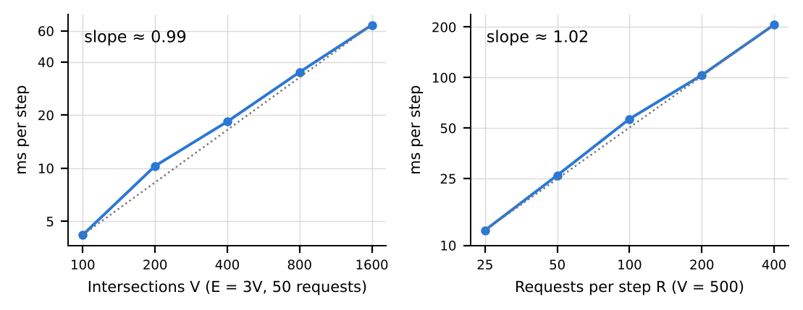
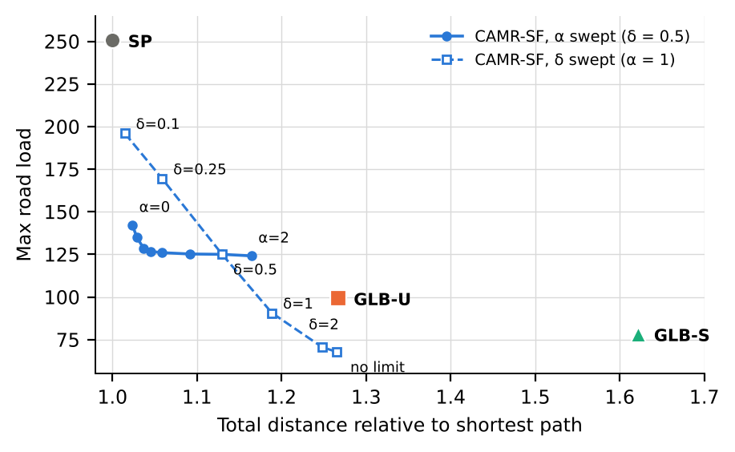

# Traffic Load Balancing and Travel Distance Optimization on Road Networks

**CAMR-SF — Corridor-Aware Marginal-cost Router**

Lab report for **CSE-2202: Algorithm Analysis and Design** (CSE, 2nd Year 2nd Term)

| Author | Roll |
|---|---|
| Kazi Shafayet Reza | 2307020 |
| Md. Imran Faraj | 2307021 |

---

## Table of Contents

1. [Problem Statement](#problem-statement)
2. [Mathematical Formulation](#mathematical-formulation)
3. [Approach: CAMR-SF](#approach-camr-sf)
4. [Pseudocode](#pseudocode)
5. [Proof of Correctness](#proof-of-correctness)
6. [Results](#results)
7. [Analysis](#analysis)
8. [Conclusion](#conclusion)

---

## Problem Statement

A city is a road map: intersections are nodes, roads are edges, and each edge weight is a road length. At every time step, groups of vehicles appear. Each group says: *"n vehicles, starting at intersection s, want to reach intersection d."* We choose their routes and **may split a group over several routes**.

The two goals conflict:

- **Shortest routes** minimise total distance but jam a few roads and leave the rest empty.
- **Spreading vehicles out** relieves busy roads but lengthens routes.

We need a compromise, and must report routes, measure them, compare against shortest-path and greedy routing, and analyse the cost.

### Considerations

- Every generated network is connected (random spanning tree first, then extra roads), so every request has at least one path.
- Every path is simple and runs from sᵢ to dᵢ. Vehicles assigned to a request always sum to nᵢ, as whole numbers.
- A route may exceed the shortest one by only a limited amount (the **detour cap**), so balancing never sends cars on absurdly long trips.
- All algorithms use the same networks, requests and seeds, with a small portable RNG (**SplitMix64**) so runs repeat on any compiler.
- Time steps are independent: each step starts with empty roads.
- The congestion penalty scales with average road length and group size, so one setting works for small and large networks.
- If the balancing search fails, we fall back to the shortest path so every request is still served.

## Mathematical Formulation

The network is a connected, undirected graph **G = (V, E, w)** with wₑ > 0. At step *t* the requests are rᵢ = (nᵢ, sᵢ, dᵢ).

- 𝒫ᵢ — set of simple sᵢ–dᵢ paths
- ℓ(p) = Σₑ∈p wₑ — path length
- d(sᵢ, dᵢ) — shortest distance
- xᵢ,ₚ ∈ ℤ≥0 — vehicles of request *i* sent on path *p*

```
Σₚ∈𝒫ᵢ xᵢ,ₚ = nᵢ   for all i
Lₑ = Σᵢ Σₚ∈𝒫ᵢ : e∈p  xᵢ,ₚ
```

### Evaluation metrics

| Metric | Definition |
|---|---|
| Max load | L_max = maxₑ Lₑ |
| Average load | L̄ = (1/\|E\|) Σₑ Lₑ |
| Variance | Var(L) = (1/\|E\|) Σₑ (Lₑ − L̄)² |
| Total distance | D = Σₑ wₑ Lₑ |

This is a **bi-objective** problem: minimise (L_max or Var(L), D) subject to the detour cap

```
ℓ(p) ≤ (1 + δ) · d(sᵢ, dᵢ)   whenever xᵢ,ₚ > 0
```

Shortest-path routing reaches the smallest possible distance D_SP = Σᵢ nᵢ · d(sᵢ, dᵢ) but ignores load. We compare algorithms using the **distance ratio D / D_SP**.

One standard way to combine both goals is the convex potential:

```
Φ(L) = Σₑ [ wₑ Lₑ + (k/2) Lₑ² ]
```

The quadratic term penalises concentrated traffic, since (1/|E|) Σ Lₑ² = Var(L) + L̄².

> **Notes**
> - With whole-number, unsplittable flows the congestion problem is **NP-hard**, so we use a heuristic.
> - L̄ counts road segments, not kilometres, so it can fall while D rises. The metrics that really matter are **L_max, Var(L) and D**.

---

## Approach: CAMR-SF

1. **Busy roads feel longer.** Each road gets a "feels-like length": real length plus a penalty growing with the cars already on it. New cars prefer other routes.
2. **Detour corridor.** A group may only use intersections that keep its whole trip within 50% of the shortest distance.
3. **Platoons.** Each request is cut into up to 6 platoons routed in rounds (every request gets a turn before any gets a second). A platoon takes the cheapest feels-like route, which changes the loads the next platoon sees.
4. **Second look.** After all platoons are placed, each is re-routed; the new route is kept only if cheaper.
5. **Fix the worst road.** Find the busiest road and move platoons off it, only onto routes where no road reaches the current peak.





*Figure 2: A request can use a direct road (length 10) or a detour (length 14). Platoons have 10 vehicles and the load penalty is 0.5 per vehicle. The first two platoons take the direct road; once it carries 20 vehicles it feels longer than the detour, so the third platoon switches.*

### Cost model

Let w̄ = mean road length, n̄ = mean group size.

```
k            = α · w̄ / n̄
c_e(q; L)    = wₑ + k · (Lₑ + q/2)
c(p; q, L)   = Σₑ∈p c_e(q; L)
```

With detour allowance δ (default **0.5**), the corridor and length budget of request *i* are:

```
Λᵢ = (1 + δ) · d(sᵢ, dᵢ)
Cᵢ = { v : d(sᵢ, v) + d(v, dᵢ) ≤ Λᵢ }
```

A search step to node *v* is allowed only if `(length so far) + d(v, dᵢ) ≤ Λᵢ`. Request *i* splits into mᵢ = min(P, nᵢ) platoons (P = 6) whose sizes differ by at most one.

| Phase | Description |
|---|---|
| **1** | For round r = 1..P, take requests in decreasing nᵢ, route platoon qᵢᵣ on the cheapest corridor path under c_e(qᵢᵣ; L), update L. |
| **2** (≤ 6 passes) | Remove a platoon's own load, find its cheapest corridor path again, switch only if c(p_new) < c(p_old). |
| **3** (≤ 50 moves) | Let e* be the busiest road with load L*. For each platoon on e*, find the cheapest corridor path with Lₑ + q < L* on every road; apply the move with the smallest cost increase. |

---

## Pseudocode

### Algorithm 1: CAMR-SF

`cost(path, q) = Σ_{e∈path} [ w(e) + k·(L(e) + q/2) ]`

```text
Input: G=(V,E,w); requests {(n_i, s_i, d_i)}; alpha, P=6, delta=0.5, p_max=6, m_max=50
1. wbar = mean w(e); nbar = mean n_i; k = alpha * wbar / nbar; L(e) = 0 for all e.
2. For each request i: run Dijkstra from s_i and from d_i (stopped beyond (1+delta)*d(s_i,d_i)).
   Lambda_i = (1+delta)*d(s_i,d_i); C_i = { v : d(s_i,v) + d(v,d_i) <= Lambda_i }.
   Split n_i into m_i = min(P, n_i) platoons of nearly equal size.
3. Phase 1: for r = 1..P: for each request i in decreasing order of n_i (if r <= m_i):
       path = CorridorRoute(i, q_ir, L, cap = infinity); if path is empty, path = shortest path.
       L(e) += q_ir for e in path; store (i, q_ir, path).
4. Phase 2: repeat up to p_max times:
       for each stored batch (i, q, path): remove q from L on path;
          cand = CorridorRoute(i, q, L, infinity);
          if cand exists and cost(cand, q) < cost(path, q): path = cand.
          add q back to L on path.
       stop when no batch moved.
5. Phase 3: repeat up to m_max times:
       e* = busiest road; Lstar = L(e*); best = none.
       for each batch (i, q, path) with e* in path: remove q from L on path;
          cand = CorridorRoute(i, q, L, cap = Lstar);
          if cand exists: keep the candidate with the smallest cost(cand,q) - cost(path,q);
          add q back to L on path.
       if best = none: stop; else move that batch to its cand path.
6. Merge batches of one request that use the same path; output paths, vehicle counts and L.
```

### Algorithm 2: CorridorRoute(i, q, L, cap)

Dijkstra with feels-like cost.

```text
1. cost[s_i] = 0; len[s_i] = 0. Repeatedly take the unfinished node u with smallest cost.
2. For each road e = (u,v): skip if v is not in C_i; skip if L(e) + q >= cap;
   newlen = len[u] + w(e); skip if newlen + d(v, d_i) > Lambda_i;
   c = cost[u] + w(e) + k*(L(e) + q/2); if c < cost[v]: update cost, len, parent of v.
3. Return the path from s_i to d_i via parents, or "empty" if d_i is not reached.
```

### Baselines (same Dijkstra, different edge cost)

```text
SP    : all n_i vehicles of every request on a shortest path (cost w(e)).
GLB-U : requests by decreasing n_i; each request goes whole on ONE path minimizing
        sum over e of [ (L(e)+n_i)^2 - L(e)^2 + 0.05*w(e) ]; update L.
GLB-S : each request is cut into platoons of size ceil(n_i/6); same cost with c in place of n_i;
        platoons are routed round-robin over requests. No corridor, refinement or peak shaving.
```

---

## Proof of Correctness

**Lemma 1 (potential).** Adding *q* vehicles along path *p* changes Φ by

```
Φ(L + q·1_p) − Φ(L) = q · Σₑ∈p [ wₑ + k(Lₑ + q/2) ] = q · c(p; q, L)
```

*Proof idea:* for one road, wₑq + (k/2)((Lₑ+q)² − Lₑ²) = q[wₑ + k(Lₑ + q/2)]; sum over e ∈ p. The feels-like cost is exactly the potential increase per vehicle, so **Phase 1 is a greedy step on Φ**.

**Lemma 2 (Phase 2 terminates).** With the platoon's own vehicles removed (L⁻), moving it from *p* to *p′* changes Φ by exactly `q · [c(p′; q, L⁻) − c(p; q, L⁻)]`. Phase 2 accepts only negative changes, so Φ strictly decreases each time. Φ is bounded below and assignments are finite, so the phase stops in a state where no single platoon can lower its own cost.

**Lemma 3 (peak shaving never creates a new peak).** On the new path every road satisfies Lₑ + q < L*, the old path only loses load, and e* drops to L* − q. The maximum load never rises and the number of roads at peak value falls with every move.

**Lemma 4 (detour cap and conservation).** The search enforces budget Λᵢ and the fallback shortest path satisfies it too, so every path is at most (1+δ)·d(sᵢ,dᵢ) long. Platoon sizes sum to nᵢ and each platoon gets exactly one path, so no vehicle is lost.

**Check by code:** 3,669 paths from 15 time steps on 500-intersection instances were recomputed, with **0 violations** of path validity, detour cap, vehicle conservation or load consistency.

**Conclusion:** CAMR-SF always returns a valid assignment within the detour cap. It remains a heuristic: results depend on platoon order, with no optimality guarantee or lower bound.

---

## Results

### Experimental setup

Each network is a random spanning tree plus random extra roads, with road lengths in [2, 20]. Each request has nᵢ ∈ [20, 100] vehicles and two distinct random endpoints.

| Tier | Intersections | Roads | Requests / step | Seeds | Time steps |
|---|---|---|---|---|---|
| Small | 20 | 45 | 10 | 10 | 5 |
| Medium | 100 | 280 | 30 | 10 | 5 |
| Large | 500 | 1500 | 80 | 10 | 5 |
| X-Large | 1500 | 4500 | 150 | 5 | 3 |
| Demo | 8 | 14 | 3–4 | – | 3 |

Settings: **α = 1, P = 6, δ = 0.5**. Times are single-threaded on one machine (useful for relative comparison only).

- **SP** — plain shortest-path routing
- **GLB-U** — unsplittable greedy balancer
- **GLB-S** — splittable greedy balancer (6 platoons, no distance limit); the strongest pure balancing baseline

### Demo network: paths, splits and loads

**Table 1 – Paths chosen by CAMR-SF (vehicles in brackets)**

| t | Request | Paths (vehicles) |
|---|---|---|
| 1 | r1: 60 veh, 0→7 | 0→3→5→7 (40); 0→2→5→6→7 (10); 0→2→5→7 (10) |
| 1 | r2: 40 veh, 1→6 | 1→4→6 (34); 1→4→5→6 (6) |
| 1 | r3: 50 veh, 0→6 | 0→2→4→6 (17); 0→1→2→5→6 (16); 0→3→5→6 (9); 0→2→5→6 (8) |
| 2 | r1: 70 veh, 0→5 | 0→2→5 (35); 0→3→5 (24); 0→1→4→5 (11) |
| 2 | r2: 45 veh, 2→7 | 2→5→7 (16); 2→4→6→7 (15); 2→4→5→7 (14) |
| 2 | r3: 55 veh, 1→7 | 1→4→5→7 (19); 1→2→4→6→7 (18); 1→4→6→7 (18) |
| 2 | r4: 30 veh, 3→6 | 3→5→6 (30) |
| 3 | r1: 80 veh, 0→7 | 0→1→4→6→7 (26); 0→2→4→6→7 (26); 0→2→5→7 (14); 0→3→5→7 (14) |
| 3 | r2: 65 veh, 1→5 | 1→2→5 (33); 1→4→5 (32) |
| 3 | r3: 40 veh, 3→7 | 3→5→7 (34); 3→5→6→7 (6) |

**Table 2 – Road loads (vehicles).** SP = shortest path at t=1; C1–C3 = CAMR-SF at t=1,2,3.

| Road | Len | SP | C1 | C2 | C3 |
|---|---|---|---|---|---|
| 0–1 | 4 | 50 | 16 | 11 | 26 |
| 0–2 | 5 | 60 | 45 | 35 | 40 |
| 0–3 | 7 | 0 | 49 | 24 | 14 |
| 1–2 | 2 | 0 | 16 | 18 | 33 |
| 1–4 | 6 | 90 | 40 | 48 | 58 |
| 2–3 | 3 | 0 | 0 | 0 | 0 |
| 2–4 | 5 | 0 | 17 | 47 | 26 |
| 2–5 | 6 | 60 | 44 | 51 | 47 |
| 3–5 | 4 | 0 | 49 | 54 | 54 |
| 4–5 | 3 | 0 | 6 | 44 | 32 |
| 4–6 | 5 | 90 | 51 | 51 | 52 |
| 5–6 | 6 | 0 | 49 | 30 | 6 |
| 5–7 | 5 | 60 | 50 | 49 | 62 |
| 6–7 | 3 | 0 | 10 | 51 | 58 |



*Figure 3: Left — shortest path puts 90 vehicles on two roads and leaves seven empty. Right — CAMR-SF uses all but one road; the busiest carries 51.*

**Table 3 – Metrics on the demo network**

| Step | Algorithm | Max load | Avg load | Variance | Total distance | Dist / SP |
|---|---|---|---|---|---|---|
| 1 | SP | 90 | 29.3 | 1249.5 | 2150 | 1.000 |
| 1 | GLB-U | 60 | 35.0 | 539.3 | 2310 | 1.074 |
| 1 | GLB-S | 57 | 32.9 | 233.6 | 2314 | 1.076 |
| 1 | **CAMR-SF** | **51** | 31.6 | 346.2 | 2296 | 1.068 |
| 2 | SP | 170 | 32.5 | 2417.0 | 2280 | 1.000 |
| 2 | GLB-U | 70 | 35.7 | 635.2 | 2425 | 1.064 |
| 2 | GLB-S | 62 | 36.3 | 258.6 | 2411 | 1.057 |
| 2 | **CAMR-SF** | **54** | 36.6 | 279.8 | 2433 | 1.067 |
| 3 | SP | 145 | 32.1 | 2370.4 | 2160 | 1.000 |
| 3 | GLB-U | 80 | 35.0 | 1092.9 | 2385 | 1.104 |
| 3 | GLB-S | 68 | 37.6 | 256.1 | 2416 | 1.119 |
| 3 | **CAMR-SF** | **62** | 36.3 | 376.1 | 2320 | 1.074 |

On the demo network CAMR-SF has the **lowest max load at every step** (51, 54, 62 vs 90, 170, 145 for SP) with distance within 7.4% of SP. GLB-S has lower variance, but CAMR-SF uses the least distance of the three balancing algorithms at t = 1 and t = 3.

### Comparison on generated networks

**Table 4 – Mean over seeds (± SD for max load); time is per step**

| Network | Algorithm | Max load | Variance | Avg load | Dist / SP | Time (ms) |
|---|---|---|---|---|---|---|
| Small | SP | 213.6 ± 29.9 | 2948.8 | 32.4 | 1.000 | 0.02 |
| Small | GLB-U | 103.2 ± 10.0 | 1164.0 | 29.7 | 1.312 | 0.02 |
| Small | GLB-S | 88.2 ± 11.6 | 364.8 | 32.4 | 1.521 | 0.11 |
| Small | CAMR-SF | 127.5 ± 22.5 | 1218.9 | 29.8 | 1.112 | 0.15 |
| Medium | SP | 287.9 ± 36.0 | 2187.6 | 22.7 | 1.000 | 0.23 |
| Medium | GLB-U | 111.8 ± 16.3 | 955.3 | 19.5 | 1.274 | 0.19 |
| Medium | GLB-S | 87.1 ± 11.7 | 168.6 | 22.9 | 1.648 | 1.49 |
| Medium | CAMR-SF | 129.8 ± 9.9 | 675.1 | 20.7 | 1.143 | 2.65 |
| Large | SP | 308.4 ± 28.8 | 1345.3 | 15.0 | 1.000 | 3.81 |
| Large | GLB-U | 118.2 ± 15.4 | 689.6 | 12.2 | 1.234 | 3.00 |
| Large | GLB-S | 93.0 ± 14.3 | 91.7 | 15.4 | 1.718 | 26.89 |
| Large | CAMR-SF | 122.2 ± 9.8 | 356.0 | 13.7 | 1.150 | 41.18 |
| X-Large | SP | 308.5 ± 30.9 | 943.3 | 11.1 | 1.000 | 21.41 |
| X-Large | GLB-U | 119.3 ± 11.8 | 535.7 | 8.9 | 1.220 | 16.48 |
| X-Large | GLB-S | 88.5 ± 16.5 | 67.9 | 11.6 | 1.748 | 151.77 |
| X-Large | CAMR-SF | 122.7 ± 9.8 | 240.1 | 10.3 | 1.151 | 212.67 |



*Figure 4: Max load, variance (log scale) and distance ratio on Small (S), Medium (M), Large (L) and X-Large (XL) networks. Whiskers = ±1 SD.*

- **vs. shortest path:** CAMR-SF cuts max load by **40%** (Small) and **55–60%** (larger). Variance drops **59–75%**, at the price of **11–15%** more distance.
- **vs. GLB-U:** On Large/X-Large, max load is within one SD (122.2 vs 118.2; 122.7 vs 119.3), variance is about half, and distance is 6–7% lower. On Small/Medium, max load is 24%/16% higher (few parallel routes fit in the corridor), but distance is still 15%/10% lower.
- **vs. GLB-S:** GLB-S has the lowest max load and variance at every size (CAMR-SF max load is 31–49% higher), but its routes are **52–75% longer** than shortest, versus 11–15% for CAMR-SF.

### Utilisation, congestion and distance

**Table 5 – Road use on one Medium instance (280 roads)**

| Algorithm | Roads used | Traffic on busiest 10% | Peak / average | Max load |
|---|---|---|---|---|
| SP | 84 / 280 | 52% | 12.9× | 282 |
| GLB-U | 99 / 280 | 47% | 5.0× | 100 |
| GLB-S | 275 / 280 | 20% | 3.4× | 80 |
| CAMR-SF | 188 / 280 | 34% | 5.0× | 106 |



- Shortest-path leaves **70%** of roads empty and puts 52% of traffic on its busiest 10%; its bottleneck (282) is 2.7–3.5× heavier than the balancing algorithms'.
- CAMR-SF uses 188 roads and matches GLB-U's peak-to-average ratio (5.0×).
- Its distance cost is small and stable (1.11–1.15, SD 0.006–0.024), while GLB-S grows from 1.52 to 1.75 with network size.
- Over five steps on one Large network, GLB-S had the lowest max load at four steps. CAMR-SF beat GLB-U at steps 1 and 4 and lost at 3 and 5. At step 2 all three load-aware methods tied at 180, suggesting a structural bottleneck (not investigated further). CAMR-SF's distance ratio stayed within 1.15–1.17.

---

## Analysis

### Time complexity

Let **D = E + V log V** (one Dijkstra run), **R** = requests per step, **D_c ≤ D** = one corridor search.

| Algorithm / Phase | Complexity |
|---|---|
| SP | O(R·D) |
| GLB-U | O(R log R + R·D) |
| GLB-S | O(P·R·D) |
| CAMR-SF setup | O(R·D) |
| Phase 1 | O(P·R·D_c) |
| Phase 2 | O(p_max·P·R·D_c) |
| Phase 3 | O(m_max·B·D_c), B ≤ P·R |
| **CAMR-SF total** | **O(R·D + (1 + p_max + m_max)·P·R·D_c) = O(P·R·D)** |

For fixed constants this is roughly linear in network size (up to a log factor) and linear in the number of requests.

### Space complexity

O(V + E + P·R·ℓ̄) for the graph, loads and stored platoon paths (ℓ̄ = mean path length).

### Running time and scalability

CAMR-SF is **8–12× slower than SP** and **1.4–1.8× slower than GLB-S**; one X-Large step takes about 0.2 s. Measured scaling exponents:

- **0.99** in the number of intersections (100 → 1,600)
- **1.02** in the number of requests (25 → 400)

Growth is close to linear. At δ = 0.5 only ~15% of intersections and 7.5% of roads are searched on a Large instance; at δ = 2 about 90% of the network is searched.



### Trade-off between balance and distance

**Table 6 – Medium networks, 10 seeds, t = 1 (SP max load: 250.5)**

| Setting | Max load | Variance | Dist / SP |
|---|---|---|---|
| α = 0 | 142.1 | 1371.7 | 1.024 |
| α = 0.5 | 125.2 | 706.6 | 1.092 |
| α = 2 (δ = 0.5) | 124.1 | 560.3 | 1.165 |
| δ = 0.1 | 196.0 | 1325.3 | 1.015 |
| δ = 0.5 (default, α = 1) | 125.0 | 610.5 | 1.130 |
| δ = 1 | 90.6 | 456.5 | 1.189 |
| δ = 2 | 70.6 | 379.8 | 1.248 |
| no corridor | 67.7 | 361.5 | 1.266 |
| GLB-U | 99.1 | 892.5 | 1.267 |
| GLB-S | 78.0 | 147.8 | 1.622 |



*Figure 7: Lower-left is better.*

- **δ is the main knob.** Widening the corridor lowers load and variance but raises distance. At δ = 1, CAMR-SF beats GLB-U on load (90.6 vs 99.1) and distance (1.189 vs 1.267). At δ = 2 its max load (70.6) is below GLB-S (78.0) with 23% less distance.
- **α saturates.** Past ~0.5 max load is almost flat (125.2 vs 124.1 at α = 2) while distance keeps rising.
- **α = 0 is not shortest path.** Max load is still 43% below SP because Phase 3 acts on loads regardless of α.
- **Phases:** splitting into platoons gives most of the variance gain; peak shaving cuts max load a further ~8% at almost no extra distance (Table 7).

**Table 7 – Contribution of each phase (Medium, 10 seeds, 5 steps)**

| Variant | Max load | Variance | Dist / SP |
|---|---|---|---|
| One batch per request, no corridor | 151.1 | 1075.4 | 1.128 |
| Phase 1 only (6 platoons, corridor) | 144.8 | 703.8 | 1.130 |
| Phases 1 + 2 | 140.9 | 675.1 | 1.140 |
| Phases 1 + 2 + 3 (full) | 129.8 | 675.1 | 1.143 |

---

## Conclusion

- Compared with shortest-path routing, CAMR-SF cuts maximum road load by **~40–60%** and variance by **59–75%**, for **11–15%** more distance, within the detour cap.
- It does not beat greedy balancing everywhere: it matches GLB-U on larger networks, is weaker on small ones, and balances less than GLB-S but with far shorter routes.
- Running time grows almost linearly. **Limits:** CAMR-SF is a heuristic with no lower bound, and the baselines have no distance limit.
